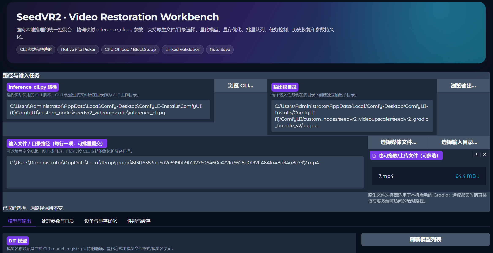
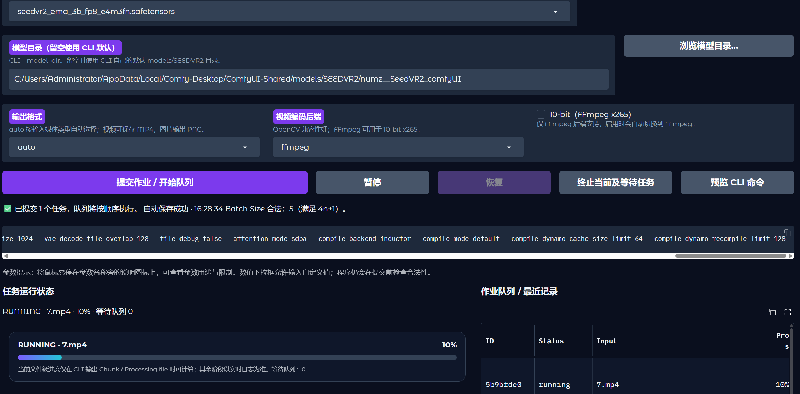
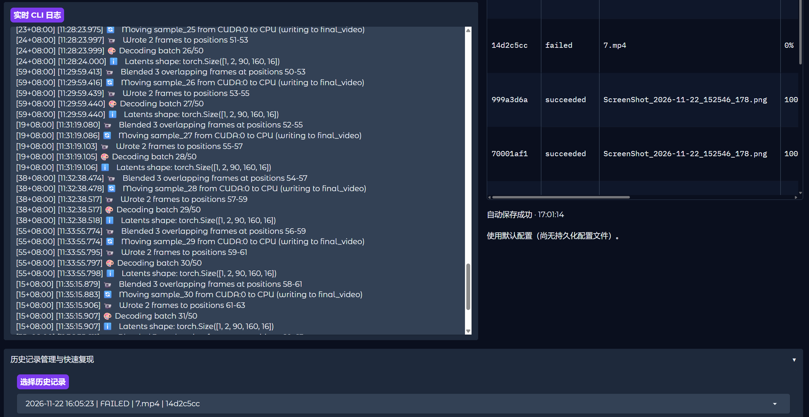

# SeedVR2 Gradio Workbench

A local Gradio GUI for the supplied `inference_cli.py`. The application **does not reimplement the SeedVR2 inference pipeline**; each queued item is launched as an independent CLI subprocess so the model loading, model downloads, multi-GPU handling, streaming, caching, tiling and output behavior remain owned by the CLI.



## 1. Installation

Place `seedvr2_gradio.py` in the same directory as `inference_cli.py`, in the SeedVR2 project root (the directory that contains the `src/` package):

```text
SeedVR2/
├── inference_cli.py
├── seedvr2_gradio.py
├── src/
├── models/
└── ...
```

Activate the same Conda environment that already runs SeedVR2, then install the GUI dependencies:

```powershell
conda activate seedvr2
python -m pip install -r requirements-seedvr2-gradio.txt
```

Or install directly:

```powershell
python -m pip install "gradio>=4.44,<7" "psutil>=5.9"
```

PyTorch, CUDA, OpenCV and the SeedVR2 dependencies are expected to be installed already. Do not replace your working PyTorch/CUDA build just to install this GUI.

## 2. Start

From the SeedVR2 project root:

```powershell
python seedvr2_gradio.py
```

Open `http://127.0.0.1:7860` if the browser does not open automatically. The GUI binds to localhost by default.

Optional environment variables:

```powershell
$env:SEEDVR2_GRADIO_HOST="127.0.0.1"
$env:SEEDVR2_GRADIO_PORT="7860"
$env:SEEDVR2_CLI="D:\AI\SeedVR2\inference_cli.py"
python seedvr2_gradio.py
```

Only expose the server on `0.0.0.0` when you intentionally need LAN access and understand that the GUI can launch inference jobs and terminate processes.

## 3. Input and batch behavior

- Enter one absolute file path or directory path per line in the input box.
- You can also multi-select files in the upload area; uploaded paths are appended to the input box.
- A directory is submitted as **one CLI job**, and the CLI performs its native directory batch processing. This preserves the CLI's `cache_dit` / `cache_vae` behavior for directory jobs.
- Several independent file paths become several queue jobs. They run serially, one CLI process at a time, to avoid concurrent model instances competing for VRAM.
- Each submitted source is written into its own output subdirectory under the selected output root, avoiding collisions between files with the same basename.

For durable restoration after restarting the app, prefer stable absolute file paths. Uploaded files can be stored in Gradio's temporary upload/cache directory, and that temporary path may not survive cache cleanup or a later restart.

## 4. Task controls and safety semantics

- **Submit**: validates paths and parameters, suppresses identical double-click submissions for a short debounce interval, then adds queue jobs.
- **Pause**: with `psutil` installed, suspends the CLI process and its child processes. This is an OS-level pause: GPU memory remains allocated while paused. If process suspension is unavailable, the pause request is retained and the queue pauses at the current job boundary; the log reports this explicitly.
- **Resume**: resumes the suspended process tree or releases a queue-boundary pause.
- **Terminate**: terminates the active CLI process tree and marks waiting jobs cancelled. The current output may be incomplete and should be checked before use.
- Repeated pause, resume and terminate clicks are treated idempotently. A single worker serializes inference jobs.

## 5. Configuration and history

The application writes these files beside `seedvr2_gradio.py`:

- `seedvr2_gradio_config.json`: all visible CLI parameters, CLI path, input paths and output root. Changes are auto-saved atomically; there is also a manual full-save button.
- `seedvr2_gradio_history.json`: task inputs, parameter snapshots, status, timing, output paths, command and recent CLI logs.

At startup, the GUI restores the last UI configuration. If the configuration or history JSON is damaged, the application attempts to preserve a `.corrupt-<timestamp>` backup and continues with defaults or an empty history. Jobs that were running when the app stopped are marked `interrupted`; they are not automatically relaunched. Use the history restore button to reload an interrupted job's input and parameters, then submit again.

Deleting an individual history record requires a confirmation checkbox. Clearing all history also requires explicit confirmation and is blocked while jobs are queued or running. History deletion does not delete generated output files.

## 6. CLI parameter coverage

The GUI exposes all options declared by the supplied `inference_cli.py` parser:

- Input/output: positional input, `--output`, `--output_format`, `--video_backend`, `--10bit`, `--model_dir`
- Model: `--dit_model`
- Processing: `--resolution`, `--max_resolution`, `--batch_size`, `--uniform_batch_size`, `--seed`, `--skip_first_frames`, `--load_cap`, `--chunk_size`, `--prepend_frames`, `--temporal_overlap`
- Quality: `--color_correction`, `--input_noise_scale`, `--latent_noise_scale`
- Devices: `--cuda_device` (where supported), `--dit_offload_device`, `--vae_offload_device`, `--tensor_offload_device`
- Memory: `--blocks_to_swap`, `--swap_io_components`, all VAE encode/decode tiling options and `--tile_debug`
- Performance: `--attention_mode`, all `torch.compile` options
- Caching/debug: `--cache_dit`, `--cache_vae`, `--debug`

Model choices are queried from the project's `src.utils.model_registry.get_available_dit_models()` where possible. If the CLI path is changed, use **刷新模型列表** to re-read the choices from that project.

## 7. Progress reporting notes

The CLI does not expose a structured callback for every internal inference phase. The GUI therefore streams the full stdout/stderr log and derives a percentage only when the CLI emits recognizable `Chunk N/M` or `Processing file N/M` messages. In other phases the task status and logs remain live, but the numeric progress may remain unchanged. This avoids inventing progress values that the CLI does not provide.

## 8. Operational notes

- Run the GUI in the same Python environment and SeedVR2 project checkout as the CLI.
- If a model/attention backend is not installed, the CLI will fail and the complete error will be shown in the log/history.
- `--10bit` requires FFmpeg and `video_backend=ffmpeg`.
- BlockSwap requires a non-`none` DiT offload device; the GUI validates common incompatible combinations before queueing.
- A directory is one CLI invocation; individual input paths are separate CLI invocations. Model cache is therefore preserved within native directory/streaming workflows, not between separate queue processes.


## 9. Enhanced path pickers, dropdowns and linked validation

The current GUI version adds the following controls while retaining the original CLI subprocess scheduler and all 43 UI parameter mappings:

- **CLI path**: `浏览 CLI…` opens a native file dialog. The selected file must be named `inference_cli.py`; after selection, the app refreshes model candidates from that project's `src.utils.model_registry` where available.
- **Output root / model directory**: `浏览输出…` and `浏览模型目录…` open native folder dialogs. An empty model-directory field deliberately omits `--model_dir`, allowing the CLI's own default model path to be used.
- **Input selection**: native multi-file and folder dialogs append selected paths to the input list. Manual absolute paths and Gradio uploads remain supported.
- **Editable dropdowns**: target resolution, max edge, Batch Size, skip-frame count, frame cap, chunk size, prepend frames, temporal overlap, BlockSwap, VAE tile sizes/overlaps, and Dynamo cache/recompile limits provide common values while allowing custom entries. Seed remains a free numeric field because it is commonly an arbitrary integer.
- **Batch Size normalization**: the UI enforces `4n+1` and automatically updates illegal or out-of-range values to the nearest bounded valid value, with a message shown beside the controls. Submission validates the normalized integer again.
- **Local device discovery**: CUDA GPU names/IDs and Apple MPS availability are queried using the Python environment that launches Gradio. The device dropdowns include the detected devices and accept custom entries; submission checks the syntax and detected device range.
- **Linked settings**: enabling BlockSwap / Swap I/O with DiT offload set to `none` switches it to `cpu`; enabling DiT/VAE cache with the corresponding offload set to `none` also selects `cpu`; changing 3B/7B updates the BlockSwap maximum; Tile Overlap must remain smaller than Tile Size; with streaming enabled, Temporal Overlap must be smaller than Chunk Size; 10-bit output switches to FFmpeg and is rejected if FFmpeg is unavailable.
- **Help text**: parameter descriptions are shown through Gradio's built-in information hints. Dropdowns with custom entry enabled still undergo submit-time range and relationship checks.

### Native dialog note

The native dialogs use Python's standard-library `tkinter.filedialog`. They are designed for a Gradio server started on the same desktop as the browser. When running on a headless server, WSL without a GUI, Docker without display forwarding, or a remote host, the native dialog may not open; the app reports the error and users can paste an absolute path into the text field. Gradio's upload control remains available for file uploads but does not replace a server-side folder path.

### Validation and relationships

The GUI validates CLI existence, input formats and directory contents, model-directory existence when specified, integer ranges, `4n+1` Batch Size, model-specific BlockSwap maxima (3B: 32, 7B: 36), CUDA/offload device strings, tile overlap constraints, streaming overlap, output-format compatibility with image inputs, FFmpeg availability, and the 10-bit/FFmpeg dependency. The CLI remains authoritative for model loading and runtime hardware/backend support; successful GUI validation does not guarantee that a given model fits in VRAM or that an optional attention/compile backend is installed.
